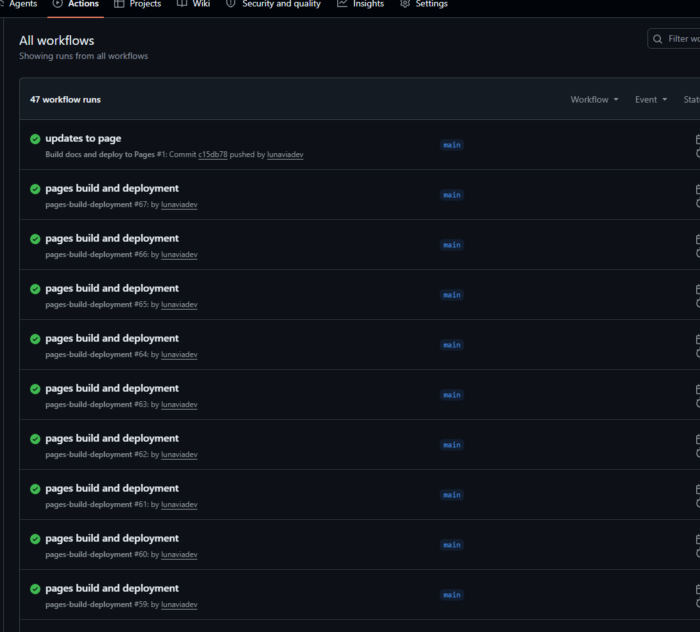
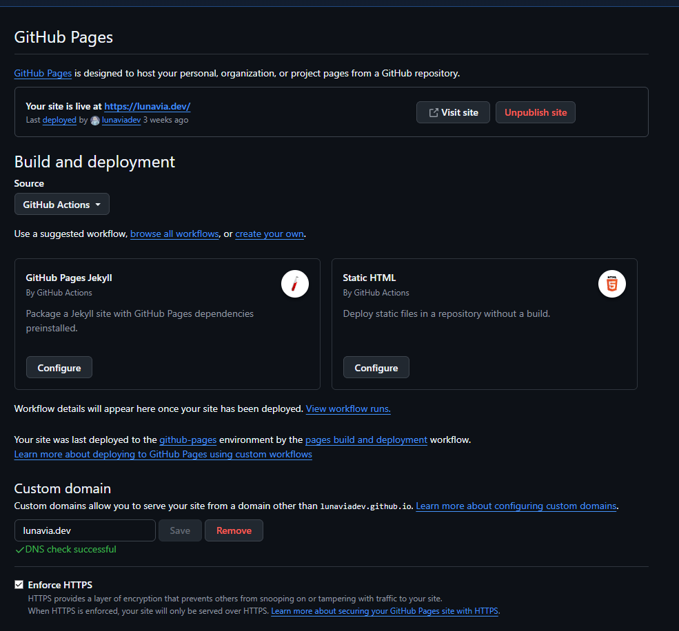
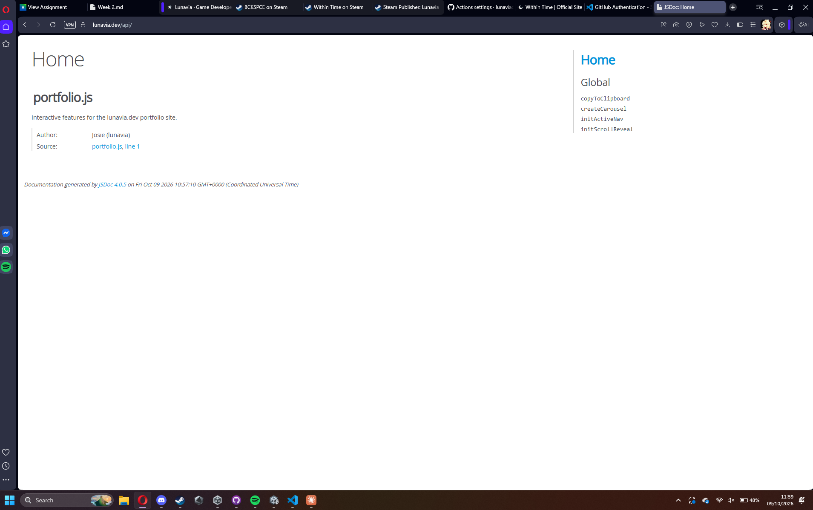

# Setup: GitHub Actions & GitHub Pages

This document explains how the portfolio site and its generated documentation are built and deployed automatically.

## 1. How the GitHub Actions workflow works

The workflow lives in [`.github/workflows/pages.yml`](../.github/workflows/pages.yml). It runs automatically every time a commit is pushed to the `main` branch, and can also be started manually from the **Actions** tab (`workflow_dispatch`).

It is split into two jobs.

### Build job

| Step | What it does |
|---|---|
| **Check out the repository** | `actions/checkout` downloads the repo onto a fresh Ubuntu runner provided by GitHub. |
| **Set up Node.js** | `actions/setup-node` installs Node 22 so `npx` is available. |
| **Generate documentation with JSDoc** | Runs `npx jsdoc src -r -d api`. JSDoc reads the `/** ... */` comments in `src/portfolio.js` and writes an HTML documentation site into an `api/` folder. |
| **Configure GitHub Pages** | `actions/configure-pages` prepares the Pages deployment settings. |
| **Upload site and docs** | `actions/upload-pages-artifact` packages the whole repository (the portfolio pages **plus** the freshly generated `api/` folder) as a Pages artifact. |

### Deploy job

The deploy job waits for the build to finish (`needs: build`), then publishes the uploaded artifact to GitHub Pages with `actions/deploy-pages`.

The workflow is granted `pages: write` and `id-token: write` permissions so it is allowed to deploy, and a `concurrency` group makes sure only one deployment runs at a time.

```
push to main ──► build job ──────────────────────────────► deploy job ──► lunavia.dev
                 checkout → setup Node → jsdoc → upload       deploy-pages
```



## 2. How GitHub Pages is enabled

1. Open the repository on GitHub → **Settings** → **Pages**.
2. Under **Build and deployment → Source**, select **GitHub Actions** instead of *Deploy from a branch*. This hands deployment over to the custom workflow above (the suggested Jekyll / Static HTML templates are not needed).
3. Under **Custom domain**, the site uses `lunavia.dev` (backed by the `CNAME` file in the repo), with **Enforce HTTPS** turned on.



## 3. Where the generated docs appear

| Page | URL |
|---|---|
| Portfolio | <https://lunavia.dev/> |
| Generated JSDoc documentation | <https://lunavia.dev/api/> |

The `api/` folder is **not** committed to the repository. It is generated fresh by the workflow on every push, so the documentation always matches the latest code in `src/`.


